# Tactical Moments: consolidated art brief (generated, review only)

One section per existing character sheet, in the owner priority order (1 front/back stand and run, 2 dribble touches, 3 pass/receive directions, 4 shuffles, 5 keeper). Every item reuses the character as drawn in its exact source asset; no lookalikes. Rows already VERIFIED_REUSABLE are omitted. Affected IDs per item: `ANIMATION_REQUIREMENTS.json` (same action/bodyFacing/travel/ball key).

- **Ground/foot anchors:** Cell 160x160 px; ground/feet anchor (80, 154). Feet must sit on the anchor in every frame; contact frames also need a contact anchor in cell px.
- **Mirror restrictions:** E→W only by a true horizontal mirror that swaps anatomical L/R, anchors and motion (it does not verify the original foot). N and S cannot be made from E/W, nor from each other.
- **Contact requirements (pass, shot, receive, dribble touch):** reviewed anatomical contact foot, supporting foot, surface (inside/outside/instep/sole), contact frame, contact anchor, ball approach and departure. The ball is drawn separately and never glued to the foot between contacts.

## boy

Source: `docs/art/team-training-v1/source/boy_highlight.png`; runtime: `src/assets/art/team-training-v1/boy.webp`

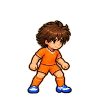

| Priority | Action | Body facing | Permitted travel | Ball | Status | Frames and timing | Contact | Uses |
|---|---|---|---|---|---|---|---|---|
| 1 | run | E | N, S, W | — | CANDIDATE_NEEDS_REVIEW | 6-frame stride cycle, phase driven by distance travelled (existing run row 0-5). | NOT_APPLICABLE | 46 |
| 1 | run | N | E, N, S, W | — | MISSING | 6-frame stride cycle, phase driven by distance travelled (existing run row 0-5). | NOT_APPLICABLE | 145 |
| 1 | run | S | E, N, S, W | — | MISSING | 6-frame stride cycle, phase driven by distance travelled (existing run row 0-5). | NOT_APPLICABLE | 122 |
| 1 | run | W | E, N, S, W | — | CANDIDATE_NEEDS_REVIEW | 6-frame stride cycle, phase driven by distance travelled (existing run row 0-5). | NOT_APPLICABLE | 58 |
| 1 | stand | N | stationary | — | MISSING | 1 frame: upright two-foot stance (existing atlas frame 6). | NOT_APPLICABLE | 316 |
| 1 | stand | S | stationary | — | MISSING | 1 frame: upright two-foot stance (existing atlas frame 6). | NOT_APPLICABLE | 308 |
| 1 | stand | W | stationary | — | CANDIDATE_NEEDS_REVIEW | 1 frame: upright two-foot stance (existing atlas frame 6). | NOT_APPLICABLE | 236 |
| 2 | dribble touch | E | E | E | MISSING | New: 6-frame carry cycle with a touch frame on each authored carry touch (none exist; currently drawn on the run cycle). | required | 1 |
| 2 | dribble touch | N | N | N | MISSING | New: 6-frame carry cycle with a touch frame on each authored carry touch (none exist; currently drawn on the run cycle). | required | 49 |
| 2 | dribble touch | W | W | W | MISSING | New: 6-frame carry cycle with a touch frame on each authored carry touch (none exist; currently drawn on the run cycle). | required | 1 |
| 3 | pass | E | stationary | E | CANDIDATE_NEEDS_REVIEW | 4 frames: plant, plant, CONTACT, follow-through (existing 7-10); contact frame held 0.12 s from ball release, follow-through to 0.30 s. | required | 10 |
| 3 | pass | N | stationary | N | MISSING | 4 frames: plant, plant, CONTACT, follow-through (existing 7-10); contact frame held 0.12 s from ball release, follow-through to 0.30 s. | required | 2 |
| 3 | pass | S | stationary | S | MISSING | 4 frames: plant, plant, CONTACT, follow-through (existing 7-10); contact frame held 0.12 s from ball release, follow-through to 0.30 s. | required | 2 |
| 3 | pass | W | stationary | W | CANDIDATE_NEEDS_REVIEW | 4 frames: plant, plant, CONTACT, follow-through (existing 7-10); contact frame held 0.12 s from ball release, follow-through to 0.30 s. | required | 7 |
| 3 | receive | N | stationary | — | MISSING | 3 frames: reach, CONTACT (first touch), settle (existing 13-15); contact held 0.15 s from arrival, settle to 0.35 s. | required | 5 |
| 3 | shot | W | stationary | W | CANDIDATE_NEEDS_REVIEW | As pass (no separate shot row exists): plant, plant, CONTACT, follow-through; contact held 0.12 s from release. | required | 2 |

## girl

Source: `docs/art/team-training-v1/source/girl_highlight.png`; runtime: `src/assets/art/team-training-v1/girl.webp`

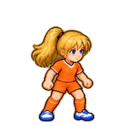

| Priority | Action | Body facing | Permitted travel | Ball | Status | Frames and timing | Contact | Uses |
|---|---|---|---|---|---|---|---|---|
| 1 | run | E | N, S, W | — | CANDIDATE_NEEDS_REVIEW | 6-frame stride cycle, phase driven by distance travelled (existing run row 0-5). | NOT_APPLICABLE | 46 |
| 1 | run | N | E, N, S, W | — | MISSING | 6-frame stride cycle, phase driven by distance travelled (existing run row 0-5). | NOT_APPLICABLE | 145 |
| 1 | run | S | E, N, S, W | — | MISSING | 6-frame stride cycle, phase driven by distance travelled (existing run row 0-5). | NOT_APPLICABLE | 122 |
| 1 | run | W | E, N, S, W | — | CANDIDATE_NEEDS_REVIEW | 6-frame stride cycle, phase driven by distance travelled (existing run row 0-5). | NOT_APPLICABLE | 58 |
| 1 | stand | N | stationary | — | MISSING | 1 frame: upright two-foot stance (existing atlas frame 6). | NOT_APPLICABLE | 316 |
| 1 | stand | S | stationary | — | MISSING | 1 frame: upright two-foot stance (existing atlas frame 6). | NOT_APPLICABLE | 308 |
| 1 | stand | W | stationary | — | CANDIDATE_NEEDS_REVIEW | 1 frame: upright two-foot stance (existing atlas frame 6). | NOT_APPLICABLE | 236 |
| 2 | dribble touch | E | E | E | MISSING | New: 6-frame carry cycle with a touch frame on each authored carry touch (none exist; currently drawn on the run cycle). | required | 1 |
| 2 | dribble touch | N | N | N | MISSING | New: 6-frame carry cycle with a touch frame on each authored carry touch (none exist; currently drawn on the run cycle). | required | 49 |
| 2 | dribble touch | W | W | W | MISSING | New: 6-frame carry cycle with a touch frame on each authored carry touch (none exist; currently drawn on the run cycle). | required | 1 |
| 3 | pass | E | stationary | E | CANDIDATE_NEEDS_REVIEW | 4 frames: plant, plant, CONTACT, follow-through (existing 7-10); contact frame held 0.12 s from ball release, follow-through to 0.30 s. | required | 10 |
| 3 | pass | N | stationary | N | MISSING | 4 frames: plant, plant, CONTACT, follow-through (existing 7-10); contact frame held 0.12 s from ball release, follow-through to 0.30 s. | required | 2 |
| 3 | pass | S | stationary | S | MISSING | 4 frames: plant, plant, CONTACT, follow-through (existing 7-10); contact frame held 0.12 s from ball release, follow-through to 0.30 s. | required | 2 |
| 3 | pass | W | stationary | W | CANDIDATE_NEEDS_REVIEW | 4 frames: plant, plant, CONTACT, follow-through (existing 7-10); contact frame held 0.12 s from ball release, follow-through to 0.30 s. | required | 7 |
| 3 | receive | N | stationary | — | MISSING | 3 frames: reach, CONTACT (first touch), settle (existing 13-15); contact held 0.15 s from arrival, settle to 0.35 s. | required | 5 |
| 3 | shot | W | stationary | W | CANDIDATE_NEEDS_REVIEW | As pass (no separate shot row exists): plant, plant, CONTACT, follow-through; contact held 0.12 s from release. | required | 2 |

## teammate_01

Source: `docs/art/team-training-v1/source/teammate_01.png`; runtime: `src/assets/art/team-training-v1/teammate_01.webp`

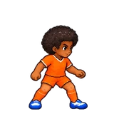

| Priority | Action | Body facing | Permitted travel | Ball | Status | Frames and timing | Contact | Uses |
|---|---|---|---|---|---|---|---|---|
| 1 | run | E | N | — | CANDIDATE_NEEDS_REVIEW | 6-frame stride cycle, phase driven by distance travelled (existing run row 0-5). | NOT_APPLICABLE | 18 |
| 1 | run | N | E, N, S | — | MISSING | 6-frame stride cycle, phase driven by distance travelled (existing run row 0-5). | NOT_APPLICABLE | 136 |
| 1 | run | S | N, S | — | MISSING | 6-frame stride cycle, phase driven by distance travelled (existing run row 0-5). | NOT_APPLICABLE | 105 |
| 1 | run | W | E, W | — | CANDIDATE_NEEDS_REVIEW | 6-frame stride cycle, phase driven by distance travelled (existing run row 0-5). | NOT_APPLICABLE | 40 |
| 1 | stand | N | stationary | — | MISSING | 1 frame: upright two-foot stance (existing atlas frame 6). | NOT_APPLICABLE | 316 |
| 1 | stand | S | stationary | — | MISSING | 1 frame: upright two-foot stance (existing atlas frame 6). | NOT_APPLICABLE | 308 |
| 1 | stand | W | stationary | — | CANDIDATE_NEEDS_REVIEW | 1 frame: upright two-foot stance (existing atlas frame 6). | NOT_APPLICABLE | 236 |
| 2 | dribble touch | N | N | N | MISSING | New: 6-frame carry cycle with a touch frame on each authored carry touch (none exist; currently drawn on the run cycle). | required | 49 |
| 3 | receive | E | stationary | W | CANDIDATE_NEEDS_REVIEW | 3 frames: reach, CONTACT (first touch), settle (existing 13-15); contact held 0.15 s from arrival, settle to 0.35 s. | required | 7 |
| 3 | receive | N | stationary | S | MISSING | 3 frames: reach, CONTACT (first touch), settle (existing 13-15); contact held 0.15 s from arrival, settle to 0.35 s. | required | 2 |
| 3 | receive | W | stationary | E | CANDIDATE_NEEDS_REVIEW | 3 frames: reach, CONTACT (first touch), settle (existing 13-15); contact held 0.15 s from arrival, settle to 0.35 s. | required | 6 |
| 4 | shuffle | S | E | — | MISSING | 6-frame side-step cycle (existing shuffle row 18-23). | NOT_APPLICABLE | 4 |

## teammate_02

Source: `docs/art/team-training-v1/source/teammate_02.png`; runtime: `src/assets/art/team-training-v1/teammate_02.webp`

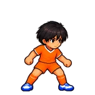

| Priority | Action | Body facing | Permitted travel | Ball | Status | Frames and timing | Contact | Uses |
|---|---|---|---|---|---|---|---|---|
| 1 | run | E | N, W | — | CANDIDATE_NEEDS_REVIEW | 6-frame stride cycle, phase driven by distance travelled (existing run row 0-5). | NOT_APPLICABLE | 34 |
| 1 | run | N | E, N | — | MISSING | 6-frame stride cycle, phase driven by distance travelled (existing run row 0-5). | NOT_APPLICABLE | 133 |
| 1 | run | W | W | — | CANDIDATE_NEEDS_REVIEW | 6-frame stride cycle, phase driven by distance travelled (existing run row 0-5). | NOT_APPLICABLE | 32 |
| 1 | stand | N | stationary | — | MISSING | 1 frame: upright two-foot stance (existing atlas frame 6). | NOT_APPLICABLE | 316 |
| 1 | stand | W | stationary | — | CANDIDATE_NEEDS_REVIEW | 1 frame: upright two-foot stance (existing atlas frame 6). | NOT_APPLICABLE | 236 |
| 2 | dribble touch | N | N | N | MISSING | New: 6-frame carry cycle with a touch frame on each authored carry touch (none exist; currently drawn on the run cycle). | required | 49 |
| 3 | receive | E | stationary | W | CANDIDATE_NEEDS_REVIEW | 3 frames: reach, CONTACT (first touch), settle (existing 13-15); contact held 0.15 s from arrival, settle to 0.35 s. | required | 7 |
| 4 | shuffle | E | E, N | — | CANDIDATE_NEEDS_REVIEW | 6-frame side-step cycle (existing shuffle row 18-23). | NOT_APPLICABLE | 3 |

## teammate_03

Source: `docs/art/team-training-v1/source/teammate_03.png`; runtime: `src/assets/art/team-training-v1/teammate_03.webp`

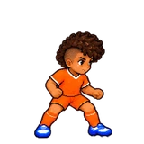

| Priority | Action | Body facing | Permitted travel | Ball | Status | Frames and timing | Contact | Uses |
|---|---|---|---|---|---|---|---|---|
| 1 | run | E | W | — | CANDIDATE_NEEDS_REVIEW | 6-frame stride cycle, phase driven by distance travelled (existing run row 0-5). | NOT_APPLICABLE | 17 |
| 1 | run | N | N | — | MISSING | 6-frame stride cycle, phase driven by distance travelled (existing run row 0-5). | NOT_APPLICABLE | 123 |
| 1 | run | W | E, W | — | CANDIDATE_NEEDS_REVIEW | 6-frame stride cycle, phase driven by distance travelled (existing run row 0-5). | NOT_APPLICABLE | 40 |
| 1 | stand | N | stationary | — | MISSING | 1 frame: upright two-foot stance (existing atlas frame 6). | NOT_APPLICABLE | 316 |
| 1 | stand | S | stationary | — | MISSING | 1 frame: upright two-foot stance (existing atlas frame 6). | NOT_APPLICABLE | 308 |
| 1 | stand | W | stationary | — | CANDIDATE_NEEDS_REVIEW | 1 frame: upright two-foot stance (existing atlas frame 6). | NOT_APPLICABLE | 236 |
| 2 | dribble touch | N | N | N | MISSING | New: 6-frame carry cycle with a touch frame on each authored carry touch (none exist; currently drawn on the run cycle). | required | 49 |
| 3 | receive | W | stationary | E | CANDIDATE_NEEDS_REVIEW | 3 frames: reach, CONTACT (first touch), settle (existing 13-15); contact held 0.15 s from arrival, settle to 0.35 s. | required | 6 |

## teammate_04

Source: `docs/art/team-training-v1/source/teammate_04.png`; runtime: `src/assets/art/team-training-v1/teammate_04.webp`

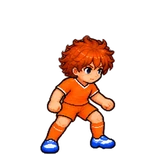

| Priority | Action | Body facing | Permitted travel | Ball | Status | Frames and timing | Contact | Uses |
|---|---|---|---|---|---|---|---|---|
| 1 | run | E | S, W | — | CANDIDATE_NEEDS_REVIEW | 6-frame stride cycle, phase driven by distance travelled (existing run row 0-5). | NOT_APPLICABLE | 30 |
| 1 | run | N | N, S | — | MISSING | 6-frame stride cycle, phase driven by distance travelled (existing run row 0-5). | NOT_APPLICABLE | 126 |
| 1 | run | S | S | — | MISSING | 6-frame stride cycle, phase driven by distance travelled (existing run row 0-5). | NOT_APPLICABLE | 94 |
| 1 | run | W | W | — | CANDIDATE_NEEDS_REVIEW | 6-frame stride cycle, phase driven by distance travelled (existing run row 0-5). | NOT_APPLICABLE | 32 |
| 1 | stand | N | stationary | — | MISSING | 1 frame: upright two-foot stance (existing atlas frame 6). | NOT_APPLICABLE | 316 |
| 1 | stand | S | stationary | — | MISSING | 1 frame: upright two-foot stance (existing atlas frame 6). | NOT_APPLICABLE | 308 |
| 1 | stand | W | stationary | — | CANDIDATE_NEEDS_REVIEW | 1 frame: upright two-foot stance (existing atlas frame 6). | NOT_APPLICABLE | 236 |
| 2 | dribble touch | N | N | N | MISSING | New: 6-frame carry cycle with a touch frame on each authored carry touch (none exist; currently drawn on the run cycle). | required | 49 |
| 3 | receive | E | stationary | W | CANDIDATE_NEEDS_REVIEW | 3 frames: reach, CONTACT (first touch), settle (existing 13-15); contact held 0.15 s from arrival, settle to 0.35 s. | required | 7 |
| 3 | receive | W | stationary | E | CANDIDATE_NEEDS_REVIEW | 3 frames: reach, CONTACT (first touch), settle (existing 13-15); contact held 0.15 s from arrival, settle to 0.35 s. | required | 6 |

## opponent_01

Source: `docs/art/team-training-v1/source/opponent_01.png`; runtime: `src/assets/art/team-training-v1/opponent_01.webp`

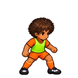

| Priority | Action | Body facing | Permitted travel | Ball | Status | Frames and timing | Contact | Uses |
|---|---|---|---|---|---|---|---|---|
| 1 | run | E | W | — | CANDIDATE_NEEDS_REVIEW | 6-frame stride cycle, phase driven by distance travelled (existing run row 0-5). | NOT_APPLICABLE | 17 |
| 1 | run | N | N | — | MISSING | 6-frame stride cycle, phase driven by distance travelled (existing run row 0-5). | NOT_APPLICABLE | 123 |
| 1 | run | S | E, N, S, W | — | MISSING | 6-frame stride cycle, phase driven by distance travelled (existing run row 0-5). | NOT_APPLICABLE | 122 |
| 1 | run | W | N, S, W | — | CANDIDATE_NEEDS_REVIEW | 6-frame stride cycle, phase driven by distance travelled (existing run row 0-5). | NOT_APPLICABLE | 50 |
| 1 | stand | N | stationary | — | MISSING | 1 frame: upright two-foot stance (existing atlas frame 6). | NOT_APPLICABLE | 316 |
| 1 | stand | S | stationary | — | MISSING | 1 frame: upright two-foot stance (existing atlas frame 6). | NOT_APPLICABLE | 308 |
| 1 | stand | W | stationary | — | CANDIDATE_NEEDS_REVIEW | 1 frame: upright two-foot stance (existing atlas frame 6). | NOT_APPLICABLE | 236 |
| 2 | dribble touch | S | S | S | MISSING | New: 6-frame carry cycle with a touch frame on each authored carry touch (none exist; currently drawn on the run cycle). | required | 20 |
| 4 | shuffle | E | W | — | CANDIDATE_NEEDS_REVIEW | 6-frame side-step cycle (existing shuffle row 18-23). | NOT_APPLICABLE | 3 |

## opponent_02

Source: `docs/art/team-training-v1/source/opponent_02.png`; runtime: `src/assets/art/team-training-v1/opponent_02.webp`

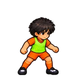

| Priority | Action | Body facing | Permitted travel | Ball | Status | Frames and timing | Contact | Uses |
|---|---|---|---|---|---|---|---|---|
| 1 | run | N | S | — | MISSING | 6-frame stride cycle, phase driven by distance travelled (existing run row 0-5). | NOT_APPLICABLE | 8 |
| 1 | run | S | E, S | — | MISSING | 6-frame stride cycle, phase driven by distance travelled (existing run row 0-5). | NOT_APPLICABLE | 106 |
| 1 | run | W | E, S, W | — | CANDIDATE_NEEDS_REVIEW | 6-frame stride cycle, phase driven by distance travelled (existing run row 0-5). | NOT_APPLICABLE | 50 |
| 1 | stand | N | stationary | — | MISSING | 1 frame: upright two-foot stance (existing atlas frame 6). | NOT_APPLICABLE | 316 |
| 1 | stand | S | stationary | — | MISSING | 1 frame: upright two-foot stance (existing atlas frame 6). | NOT_APPLICABLE | 308 |
| 1 | stand | W | stationary | — | CANDIDATE_NEEDS_REVIEW | 1 frame: upright two-foot stance (existing atlas frame 6). | NOT_APPLICABLE | 236 |
| 2 | dribble touch | S | S | S | MISSING | New: 6-frame carry cycle with a touch frame on each authored carry touch (none exist; currently drawn on the run cycle). | required | 20 |
| 4 | shuffle | E | N, W | — | CANDIDATE_NEEDS_REVIEW | 6-frame side-step cycle (existing shuffle row 18-23). | NOT_APPLICABLE | 5 |
| 4 | shuffle | S | W | — | MISSING | 6-frame side-step cycle (existing shuffle row 18-23). | NOT_APPLICABLE | 1 |
| 4 | shuffle | W | S, W | — | CANDIDATE_NEEDS_REVIEW | 6-frame side-step cycle (existing shuffle row 18-23). | NOT_APPLICABLE | 4 |

## opponent_03

Source: `docs/art/team-training-v1/source/opponent_03.png`; runtime: `src/assets/art/team-training-v1/opponent_03.webp`

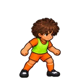

| Priority | Action | Body facing | Permitted travel | Ball | Status | Frames and timing | Contact | Uses |
|---|---|---|---|---|---|---|---|---|
| 1 | run | E | S | — | CANDIDATE_NEEDS_REVIEW | 6-frame stride cycle, phase driven by distance travelled (existing run row 0-5). | NOT_APPLICABLE | 15 |
| 1 | run | S | E, S | — | MISSING | 6-frame stride cycle, phase driven by distance travelled (existing run row 0-5). | NOT_APPLICABLE | 106 |
| 1 | stand | N | stationary | — | MISSING | 1 frame: upright two-foot stance (existing atlas frame 6). | NOT_APPLICABLE | 316 |
| 1 | stand | S | stationary | — | MISSING | 1 frame: upright two-foot stance (existing atlas frame 6). | NOT_APPLICABLE | 308 |
| 1 | stand | W | stationary | — | CANDIDATE_NEEDS_REVIEW | 1 frame: upright two-foot stance (existing atlas frame 6). | NOT_APPLICABLE | 236 |

## opponent_04

Source: `docs/art/team-training-v1/source/opponent_04.png`; runtime: `src/assets/art/team-training-v1/opponent_04.webp`

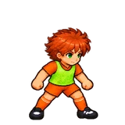

| Priority | Action | Body facing | Permitted travel | Ball | Status | Frames and timing | Contact | Uses |
|---|---|---|---|---|---|---|---|---|
| 1 | run | N | N, S, W | — | MISSING | 6-frame stride cycle, phase driven by distance travelled (existing run row 0-5). | NOT_APPLICABLE | 135 |
| 1 | run | S | E, N, S, W | — | MISSING | 6-frame stride cycle, phase driven by distance travelled (existing run row 0-5). | NOT_APPLICABLE | 122 |
| 1 | run | W | N, W | — | CANDIDATE_NEEDS_REVIEW | 6-frame stride cycle, phase driven by distance travelled (existing run row 0-5). | NOT_APPLICABLE | 40 |
| 1 | stand | N | stationary | — | MISSING | 1 frame: upright two-foot stance (existing atlas frame 6). | NOT_APPLICABLE | 316 |
| 1 | stand | S | stationary | — | MISSING | 1 frame: upright two-foot stance (existing atlas frame 6). | NOT_APPLICABLE | 308 |
| 1 | stand | W | stationary | — | CANDIDATE_NEEDS_REVIEW | 1 frame: upright two-foot stance (existing atlas frame 6). | NOT_APPLICABLE | 236 |
| 2 | dribble touch | S | S | S | MISSING | New: 6-frame carry cycle with a touch frame on each authored carry touch (none exist; currently drawn on the run cycle). | required | 20 |
| 4 | shuffle | S | E | — | MISSING | 6-frame side-step cycle (existing shuffle row 18-23). | NOT_APPLICABLE | 4 |

## keeper_home

Source: `docs/art/team-training-v1/source/home_keeper_keyposes.png`; runtime: `src/assets/art/team-training-v1/keeper_home.webp`

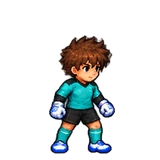

| Priority | Action | Body facing | Permitted travel | Ball | Status | Frames and timing | Contact | Uses |
|---|---|---|---|---|---|---|---|---|
| 1 | stand | N | stationary | — | MISSING | 1 frame: upright two-foot stance (existing atlas frame 6). | NOT_APPLICABLE | 316 |
| 3 | receive | N | stationary | E | MISSING | 3 frames: reach, CONTACT (first touch), settle (existing 13-15); contact held 0.15 s from arrival, settle to 0.35 s. | required | 2 |
| 5 | keeper ready | N | stationary | — | MISSING | 1 frame: keeper ready stance (keeper strip pose 3). | NOT_APPLICABLE | 80 |

## keeper_away

Source: `docs/art/team-training-v1/source/opposition_keeper_keyposes.png`; runtime: `src/assets/art/team-training-v1/keeper_away.webp`

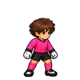

| Priority | Action | Body facing | Permitted travel | Ball | Status | Frames and timing | Contact | Uses |
|---|---|---|---|---|---|---|---|---|
| 1 | stand | S | stationary | — | MISSING | 1 frame: upright two-foot stance (existing atlas frame 6). | NOT_APPLICABLE | 308 |
| 1 | stand | W | stationary | — | CANDIDATE_NEEDS_REVIEW | 1 frame: upright two-foot stance (existing atlas frame 6). | NOT_APPLICABLE | 236 |
| 5 | keeper ready | S | stationary | — | MISSING | 1 frame: keeper ready stance (keeper strip pose 3). | NOT_APPLICABLE | 64 |
